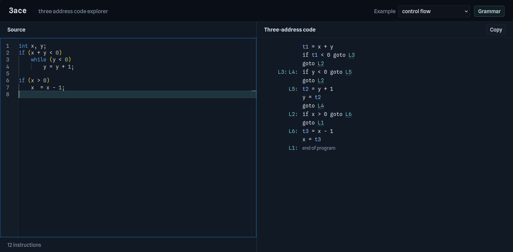

# 3ace

_Three address code explorer_



A toy compiler frontend demonstrating various schemes for intermediate code generation, visualising generation of three address code for any given source text.

## Reference

This follows (with some modifications) the translation schemes as defined in _Chapter 6: Intermediate Code Generation_ in _Compilers: Principles, Techniques, and Tools, 2nd edition, Addison-Wesley, 2006_ (coloquially called The Dragon Book).

## Example

This is the example demonstrated in the screenshot above.

<table>
    <thead>
        <tr>
            <th>Source</th>
            <th>Three-address code </th>
        </tr>
    </thead>
    <tbody>
        <tr>
            <td>
            
```c
int x, y;
if (x + y < 0)
    while (y < 0)
        y = y + 1;

if (x > 0) 
    x  = x - 1;
```

</td>
            <td>
            
```ir
t1 = x + y
if t1 < 0 goto L3
goto L2
L3: 	L4: 	if y < 0 goto L5
goto L2
L5: 	t2 = y + 1
y = t2
goto L4
L2: 	if x > 0 goto L6
goto L1
L6: 	t3 = x - 1
x = t3
L1: 	
```

</td>
        </tr>
    </tbody>
</table>

## Language

The toy language supports the following basic features:
- Variable declarations with array types
- Arithmetic expressions
- Array references
- Assignment statements
- Control flow statements (`if`, `if-else`, `while`, `for`)
- Short-Circuiting Boolean Expressions

## Implementation

The parsing happens via a Yacc grammar (`icg.y`).

The basic translation scheme for generating three address code (without fancy techniques like backpatching) is given as a syntax-directed definition, which requires inherited-attributes to pass down labels which occur later in the generated code. Thus, the semantic rules cannot be implemented directly during parsing. They are deferred to a later stage, after the complete parsing happens and generates an *abstact syntax tree*.

The AST comprises of nodes (`tree.h`) which are implemented as an hierarchy of classes using C++ object oriented constructs. Each node has a `getCode()` method which actually implements the semantic rules. The entire code generation process happens via a recursive call on the root node of the AST, which in turn passes the inherited attributes down the tree as required, and generate the IR code. Instead of outputting a string, they construct a structural representation of the generated IR.

## Tests

Some tests are present in `/tests/`, which can be run using 

```
./tests/run.sh
```

## Integration

For a web demonstration of this application, the entire C++ code is compiled into WebAssembly using Emscripten (`em++`), which generates `web/icg.wasm` and a `web/icg.js` wrapper.

The frontend (`web/index.html`) allows the user to type any code in the (Monaco) code editor, and invokes the WASM code to translate it into the IR code and displays it.

## License

[MIT](./LICENSE)